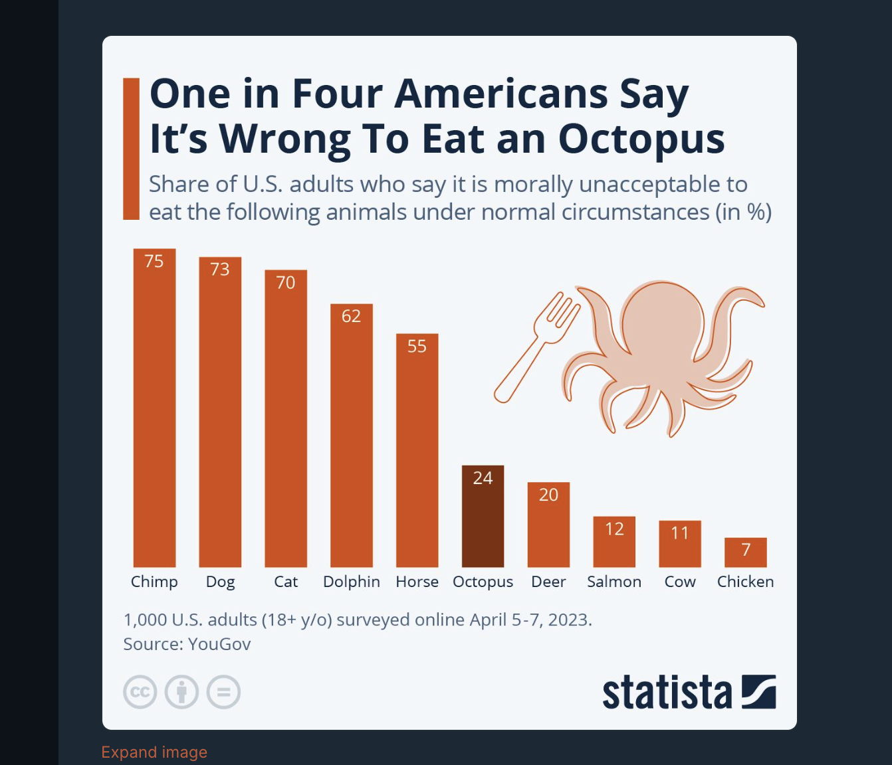
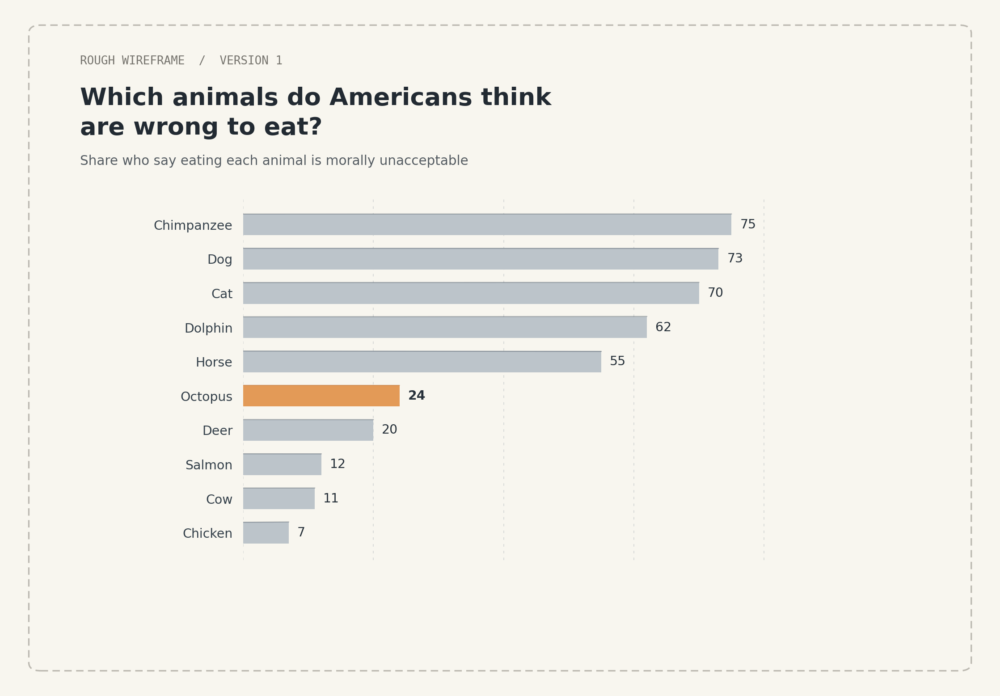

| [home page](https://imsh4ron.github.io/dataviz-portfolio/) | [data viz examples](dataviz-examples) | [critique by design](critique-by-design) | [final project I](final-project-part-one) | [final project II](final-project-part-two) | [final project III](final-project-part-three) |

[← Back to portfolio home](https://imsh4ron.github.io/dataviz-portfolio/)

# Critique by Design: Which Animals Do Americans Think Are Wrong to Eat?

*MakeoverMonday 2024, Week 7 (February 12, 2024) · Sharon Yu*

## 1. Original Visualization

*"One in Four Americans Say It's Wrong to Eat an Octopus" by [Statista](https://www.statista.com/chart/30299/us-survey-on-ethics-of-eating-animals/). Data: YouGov survey of 1,000 U.S. adult citizens, April 5–7, 2023. Licensed CC BY-ND. Click the image to see the original.*

## 2. Why I Chose This Visualization

I chose this chart because I thought the topic was pretty interesting. It shows how differently Americans feel about eating certain animals. The original chart is already easy to understand, but I felt like some parts of the design could be improved, especially the labels and the overall layout.

## 3. Critique of the Original

I used Stephen Few's Data Visualization Effectiveness Profile (through the Google Form from class) to look at the chart more carefully.

### Effectiveness Profile

| Dimension | Rating |
|---|---|
| Usefulness | 8/10 |
| Completeness | 8/10 |
| Perceptibility | 7/10 |
| Truthfulness | 9/10 |
| Intuitiveness | 9/10 |
| Aesthetics | 7/10 |
| Engagement | 8/10 |

*These are the ratings from my critique notes.*

### What Worked Well

I think the original chart is pretty easy to understand. The title catches my attention, and the percentages are clearly labeled. I also like the colors and how the octopus is highlighted. The chart is already sorted from highest to lowest, which makes the overall ranking easy to follow.

### What Could Be Improved

Some animal names are pretty small, especially with the vertical bar chart. The large octopus illustration also takes up a lot of space. While it makes the chart more interesting, it doesn't really help explain the numbers. I thought a horizontal layout could make the labels easier to read and give the data more space.

### Target Audience

I think the main audience is the general public, especially people interested in food, animals, and ethical issues. The original visualization works pretty well for this audience because it uses a familiar chart type and simple percentages.

### Stephen Few vs. Good Charts

I think Stephen Few's method is more structured because it gives us specific criteria to evaluate, such as usefulness, clarity, and truthfulness. Good Charts puts more emphasis on communication, audience, and storytelling.

I found both useful. Stephen Few helped me identify specific design issues, while Good Charts helped me think about what story I wanted readers to take away.

One limitation is that numerical ratings can be subjective. Two people may give different scores to the same chart even if they notice similar strengths and weaknesses.

## 4. Initial Sketch and Design Rationale

*My initial wireframe (version 1), before peer feedback.*

For my initial redesign, I wanted to keep the chart simple and make the data easier to compare.

First, I switched from vertical bars to horizontal bars because some of the animal names are pretty long. This makes the labels easier to read.

I kept the descending order from the original chart because it helps readers quickly compare the animals.

I also kept the focus on the octopus but made the color contrast more intentional. I used orange for the octopus and a neutral color for the other animals.

Finally, I removed the large illustration to reduce distractions and give the data more space.

Overall, I focused on readability, clearer comparisons, and visual hierarchy.

## 5. Peer Feedback and Iteration

I showed my initial sketch to two classmates and took notes using a Design Kit feedback worksheet. (No names are shared here.)

### Participant 1

My classmate liked the orange highlight for the octopus and the switch from vertical to horizontal bars. They thought these changes made the chart easier to follow.

They also suggested showing the exact percentages more clearly, especially the 24% for octopus.

One of their main suggestions was adding a dashed reference line at 25%. Since the title says "one in four," they thought the line would help readers connect the title to the actual data.

They also asked about the data source, which made me realize that I should make the source information easier to find.

### Participant 2

My second classmate suggested adding percentage signs to the numbers because it wasn't immediately clear what they represented. They also recommended simplifying the unnecessary text.

### Changes Based on Feedback

| Feedback | What I changed |
|---|---|
| Show exact percentages more clearly (P1) | Added percentage labels to all bars |
| Connect "one in four" to the data (P1) | Added a dashed reference line at 25%, labeled "1 in 4 (25%)" |
| Liked the orange highlight and horizontal bars (P1) | Kept both |
| Make the source easier to find (P1) | Added the YouGov survey information below the chart |
| Numbers weren't clearly percentages (P2) | Added a % sign to every value |
| Simplify unnecessary text (P2) | Cut extra text to improve overall readability |

The 25% reference line was especially helpful because it directly connects the headline to the 24% result.

## 6. Final Visualization

*"Octopus Redesign – MakeoverMonday 2024" by Xiaorong Yu, made in Tableau Public.*

<noscript></noscript><object class='tableauViz' style='display:none;'><param name='host_url' value='https%3A%2F%2Fpublic.tableau.com%2F' /> <param name='embed_code_version' value='3' /> <param name='site_root' value='' /><param name='name' value='OctopusRedesignMakeoverMonday2024&#47;Sheet1' /><param name='tabs' value='no' /><param name='toolbar' value='yes' /><param name='static_image' value='https:&#47;&#47;public.tableau.com&#47;static&#47;images&#47;Oc&#47;OctopusRedesignMakeoverMonday2024&#47;Sheet1&#47;1.png' /> <param name='animate_transition' value='yes' /><param name='display_static_image' value='yes' /><param name='display_spinner' value='yes' /><param name='display_overlay' value='yes' /><param name='display_count' value='yes' /><param name='language' value='en-US' /><param name='filter' value='publish=yes' /></object>

*If the chart doesn't load, [view it on Tableau Public](https://public.tableau.com/views/OctopusRedesignMakeoverMonday2024/Sheet1).*

### What Changed in the Final Version?

The final version uses horizontal bars, clearer labels, and a simpler layout.

I kept octopus highlighted because it is the main focus of the original article. I also added exact percentages with % signs and a 25% reference line based on peer feedback.

I removed the decorative illustration and added the survey source information so readers can understand where the data came from.

The goal was not to completely change the original story, but to make it easier to read and understand.

## 7. Reflection

This project made me realize that redesigning a visualization isn't just about making it look better. It's also about thinking about what readers notice first and whether they can understand the main takeaway.

At first, I mainly wanted to change the vertical bars to horizontal bars and simplify the colors. But after getting feedback, I realized that small details, like adding a 25% reference line, can make the message much clearer.

I also learned that an interesting design isn't always the clearest design. The original octopus illustration made the chart more eye-catching, but I think removing it gave the data more attention.

Overall, I tried to keep the original story while improving readability and making the chart more straightforward.

## 8. Sources and AI Acknowledgment

### Sources

- Statista. (2023). *One in Four Americans Say It's Wrong to Eat an Octopus.* [https://www.statista.com/chart/30299/us-survey-on-ethics-of-eating-animals/](https://www.statista.com/chart/30299/us-survey-on-ethics-of-eating-animals/)
- MakeoverMonday. (2024). *2024 Week 7 submissions.* [https://makeovermonday.vercel.app/submissions/2024/7](https://makeovermonday.vercel.app/submissions/2024/7)
- YouGov. (2023). *Vegetarianism and eating meat* survey, conducted April 5–7, 2023, 1,000 U.S. adult citizens. <!-- TODO: add link to the original YouGov survey PDF -->
- Few, S. (2017). *Data Visualization Effectiveness Profile.* Perceptual Edge. [http://www.perceptualedge.com/articles/visual_business_intelligence/data_visualization_effectiveness_profile.pdf](http://www.perceptualedge.com/articles/visual_business_intelligence/data_visualization_effectiveness_profile.pdf)
- Berinato, S. (2016). *Good Charts: The HBR Guide to Making Smarter, More Persuasive Data Visualizations.* Harvard Business Review Press.

### AI Acknowledgment

I used ChatGPT to help brainstorm design ideas, organize my critique, develop an initial Python wireframe, and draft parts of the written explanation. I used Claude to help organize and build the GitHub Pages assignment page. I created the final visualization in Tableau Public using the YouGov data.

[← Back to portfolio home](https://imsh4ron.github.io/dataviz-portfolio/)
