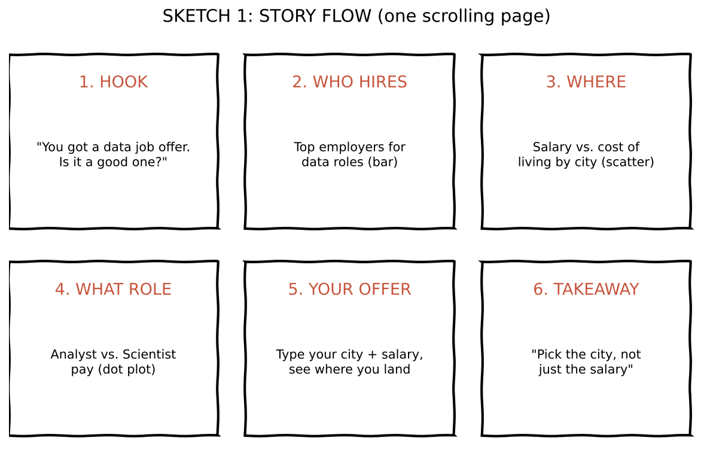
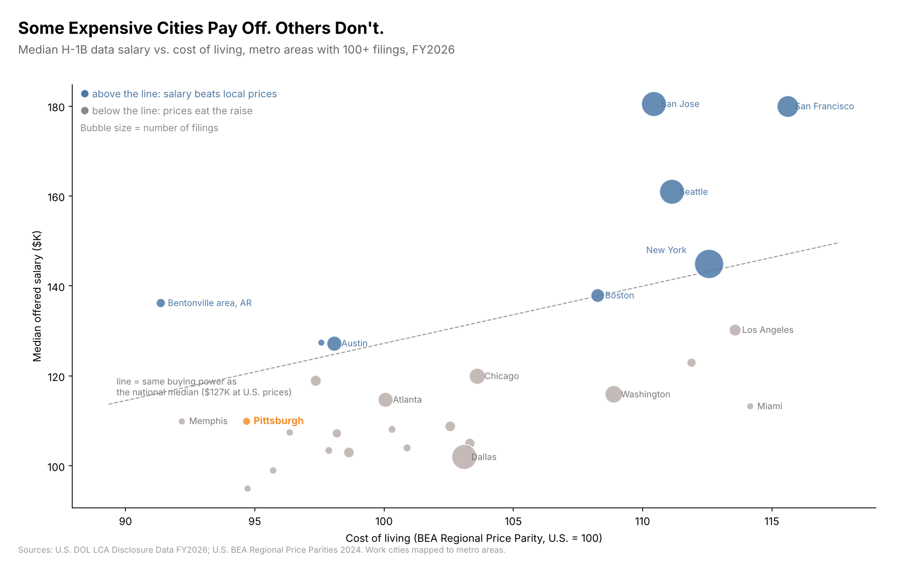
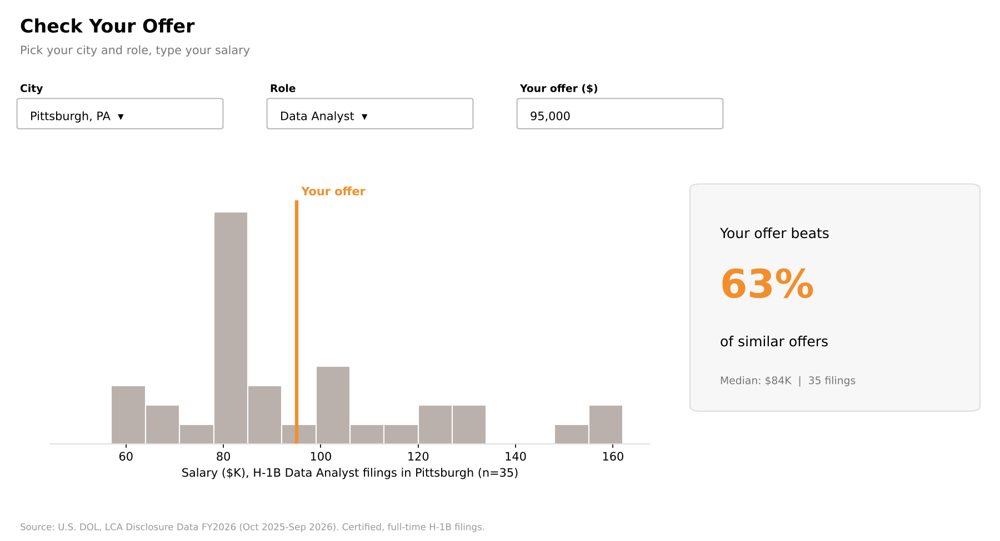

| [home page](https://imsh4ron.github.io/dataviz-portfolio/) | [data viz examples](dataviz-examples) | [critique by design](critique-by-design) | [final project I](final-project-part-one) | [final project II](final-project-part-two) | [final project III](final-project-part-three) |

[← Back to portfolio home](https://imsh4ron.github.io/dataviz-portfolio/)

# Final Project Part I: Is Your Data Job Offer a Good One?

*Where H-1B data jobs are, who offers them, and what they really pay*

# Outline
Many international students at CMU, including me, want a data analyst or data scientist job after graduation. When an offer comes in, it is hard to know if it is a good one. Is $95,000 high or low? Is a job in New York better than one in Pittsburgh? Most of us compare offers with friends or guess.

Every company that hires someone on an H-1B visa must file a public form with the U.S. Department of Labor. The form lists the job title, the company, the city, and the salary. This means there is real, public salary data for thousands of data jobs. My project uses this data to help students see how their offer compares with similar offers.

The story moves from "who hires" to "where" to "what role," and ends with a tool where readers enter their own city, role and salary to see where it falls among similar H-1B salary filings. The project is about jobs, companies, cities, and pay. It does not discuss visa policy.

**One-sentence summary:** For international students getting data job offers, H-1B salary records show that how an offer compares depends on the city and the role, not just the number.

**Audience:** International graduate students in data programs (like Heinz MSISPM/BIDA) who are searching for or comparing full-time data jobs.

**User stories**
- As a student with an offer, I want to know how my offer compares with other H-1B salary filings for similar roles in my city, so I can negotiate with more information.
- As a student starting my search, I want to know which companies hire data people on H-1B, so I can focus my applications.
- As a student choosing between cities, I want to see how salaries compare across cities once regional price differences are taken into account.

### Story structure

Following the story arc from Good Charts (setup, conflict, resolution):

| Part | Section | What the reader sees | Main point |
|---|---|---|---|
| Setup | 1. Hook | A hypothetical offer: "You got a $95K data analyst offer in Pittsburgh. Is that high or low?" | Everyone faces this question, and most of us just guess |
| Conflict | 2. Who hires | Bar chart of top employers for data roles | The companies that file the most do not always offer the most |
| Conflict | 3. Where | Scatter plot of median salary vs. regional price level by metro | A high salary can look smaller once local prices are considered |
| Conflict | 4. What role | Dot plot of Data Analyst vs. Data Scientist salary ranges | The job title makes a big difference in pay |
| Resolution | 5. Your offer | Interactive tool: pick city and role, enter salary, see where it falls | Readers can compare their offer with similar LCA salary records |
| Resolution | 6. Takeaway | Three short tips (compare by city, check the title, use the data to negotiate) | Look at the city and role, not just the number |

## Initial sketches
Sketches 2-5 use real FY2026 data. Sketch 2 was built in Tableau Public; the others are quick drafts that I will rebuild in Tableau for Part II. Sketch 5 is a design idea, not a working tool yet.

**Sketch 1: Story flow.** The project is one scrolling page with six sections.

**Sketch 2: Who hires.** Left: number of filings. Right: median offered salary. Amazon and Capital One have the most filings (848 and 547), but rank #10 and #13 in median pay among the top 15. The dashed line is the median for all data jobs in my data ($124K). Note: filing counts are applications, not confirmed hires or unique job openings.

Interactive version: [view on Tableau Public](https://public.tableau.com/views/finalproject_17949784635000/Dashboard1)

<noscript></noscript><object class='tableauViz' style='display:none;'><param name='host_url' value='https%3A%2F%2Fpublic.tableau.com%2F' /><param name='embed_code_version' value='3' /><param name='site_root' value='' /><param name='name' value='finalproject_17949784635000&#47;Dashboard1' /><param name='tabs' value='no' /><param name='toolbar' value='yes' /><param name='static_image' value='https://public.tableau.com/static/images/fi/finalproject_17949784635000/Dashboard1/1.png' /><param name='animate_transition' value='yes' /><param name='display_static_image' value='yes' /><param name='display_spinner' value='yes' /><param name='display_overlay' value='yes' /><param name='display_count' value='yes' /><param name='language' value='en-US' /><param name='filter' value='publish=yes' /></object>

**Sketch 3: Where.** Each dot is a metro area. The x-axis is the BEA Regional Price Parity, which measures how high local prices are compared with the U.S. average (U.S. = 100). It is not the same as actual living costs or after-tax savings, so this is only a rough comparison of buying power. Dots above the dashed line have higher typical salaries than their price level alone would suggest. Some high-price metros, like San Jose, San Francisco and Seattle, stay above the line, while others, like Washington DC and Los Angeles, fall below it. Pittsburgh (median $121K, price index 95) is highlighted because it is where my readers are now.

**Sketch 4: What role.** Data Analyst median is $104K, Data Scientist is $142K. The box is the middle 50% of salaries. Roles are grouped by job title (see the data section for the exact rules). This sketch is now built in Tableau Public.

[Open in Tableau Public](https://public.tableau.com/views/finalproject_roles/Roles)

<noscript></noscript><object class='tableauViz' style='display:none;'><param name='host_url' value='https%3A%2F%2Fpublic.tableau.com%2F' /><param name='embed_code_version' value='3' /><param name='site_root' value='' /><param name='name' value='finalproject_roles&#47;Roles' /><param name='tabs' value='no' /><param name='toolbar' value='yes' /><param name='static_image' value='https://public.tableau.com/static/images/fi/finalproject_roles/Roles/1.png' /><param name='animate_transition' value='yes' /><param name='display_static_image' value='yes' /><param name='display_spinner' value='yes' /><param name='display_overlay' value='yes' /><param name='display_count' value='yes' /><param name='language' value='en-US' /><param name='filter' value='publish=yes' /></object>

**Sketch 5: Check your offer.** Readers choose a city and role and type a salary. Example: a $95K data analyst offer in Pittsburgh is higher than 63% of the 35 matching filings. The tool will always show the sample size, with a note like: "Based on 35 matching LCA filings. This does not account for experience, seniority, bonus or stock." Groups with very few filings will get a warning.

# The data
**Main source: U.S. Department of Labor, LCA Disclosure Data (H-1B program).** The Office of Foreign Labor Certification publishes every Labor Condition Application each quarter. Each row has the employer, job title, SOC job code, work city and state, offered wage, wage unit (year, hour, etc.), and the prevailing wage. I use all four quarters of fiscal year 2026 (October 2025 to September 2026), 553,859 filings in total.

**How I will use the data.** The raw LCA files are very large (hundreds of thousands of rows per quarter), so I clean them in Python ([clean_lca.py](fp1/data/clean_lca.py) and [metro.py](fp1/data/metro.py)). I keep only certified, full-time H-1B cases, convert all wages to yearly salary, remove impossible values (below $30K or above $500K), and merge different spellings of the same company (for example, the TikTok and ByteDance entities).

I group roles by **job title only**:
- **Data Analyst:** the title contains "data analyst," "business intelligence," or "BI analyst." Business intelligence roles are counted here.
- **Data Scientist:** the title contains "data scientist" or "data science."
- If a title matches both, it counts as Data Analyst. Everything else is left out.

I do not use the SOC job code to define roles. Many filings use the Data Scientist code (15-2051) for jobs like Data Engineer or Machine Learning Engineer, so the code alone would mix in other jobs. After cleaning, **16,570 data jobs** remain (6,986 Data Analyst, 9,584 Data Scientist).

For Sketch 3, I map each work city to its metro area and join the BEA 2024 Regional Price Parity. About 76% of filings match a metro; the rest are in smaller towns and are left out of that chart. The charts are made from summary tables by employer, by metro area and by role.

**Limits.** An LCA is filed before hiring, so it shows the offered base salary, not final pay, and not every filing becomes a hire. Filing counts are applications, not unique job openings. The data does not include bonus or stock, and it does not control for experience or level. I will say this clearly on the page.

| Name | URL | Description |
|------|-----|-------------|
| DOL LCA Disclosure Data, FY2026 (Q1-Q4) | [dol.gov](https://www.dol.gov/agencies/eta/foreign-labor/performance) | Every H-1B Labor Condition Application: employer, job title, work city, offered wage. Main data source. |
| BEA Regional Price Parities by MSA, 2024 | [bea.gov](https://www.bea.gov/data/prices-inflation/regional-price-parities-state-and-metro-area) | Relative price level by metro area (U.S. = 100). Used for Sketch 3. |
| Cleaned data (my copy) | [tableau_data.csv](fp1/data/tableau_data.csv) | 16,570 certified, full-time H-1B data analyst and data scientist jobs with yearly salary, metro area and regional price parity. |
| Metro summary (my copy) | [summary_by_metro.csv](fp1/data/summary_by_metro.csv) | Median salary and price-adjusted salary for metros with 90+ filings. |
| USCIS H-1B Employer Data Hub | [uscis.gov](https://www.uscis.gov/tools/reports-and-studies/h-1b-employer-data-hub) | Approved and denied petitions by employer. Planned for Part II. |
| BLS OEWS | [bls.gov](https://www.bls.gov/oes/) | Market-wide pay for data scientists by metro. Planned for Part II, to compare with H-1B pay. |

# Method and medium
I will build the story in **Shorthand** as one scrolling page, with charts made in **Tableau Public** and embedded in each section. Data cleaning and summary tables will be done in **Python (pandas)**. The "check your offer" tool will be a Tableau dashboard with city and role filters and a salary parameter, embedded in the resolution section. The final Shorthand page will be linked from this GitHub portfolio.

## References
U.S. Department of Labor, Office of Foreign Labor Certification. (2026). *LCA Programs (H-1B, H-1B1, E-3) Disclosure Data, FY2026.* https://www.dol.gov/agencies/eta/foreign-labor/performance

U.S. Citizenship and Immigration Services. (2026). *H-1B Employer Data Hub.* https://www.uscis.gov/tools/reports-and-studies/h-1b-employer-data-hub

U.S. Bureau of Labor Statistics. (2026). *Occupational Employment and Wage Statistics.* https://www.bls.gov/oes/

U.S. Bureau of Economic Analysis. (2026). *Regional Price Parities by State and Metro Area.* https://www.bea.gov/data/prices-inflation/regional-price-parities-state-and-metro-area

Berinato, S. (2023). *Good charts: The HBR guide to making smarter, more persuasive data visualizations* (Updated and expanded ed.). Harvard Business Review Press.

## AI acknowledgements
I used Claude (Anthropic) to help find public data sources, assist with writing Python scripts to clean the DOL data and merge it with BEA data, and create initial matplotlib sketches (Sketches 1, 3 and 5, and the first draft of Sketch 4, which I later rebuilt in Tableau myself) based on my ideas. I also used ChatGPT (OpenAI) to review my draft and suggest improvements to the role definitions and explanations of salary comparisons and regional price differences. Additionally, I used Grammarly to improve the grammar and clarity of my writing.

I independently selected the topic, developed the story direction and visualization ideas, downloaded the data, created Sketch 2 in Tableau, and reviewed the data and visualizations for accuracy.
