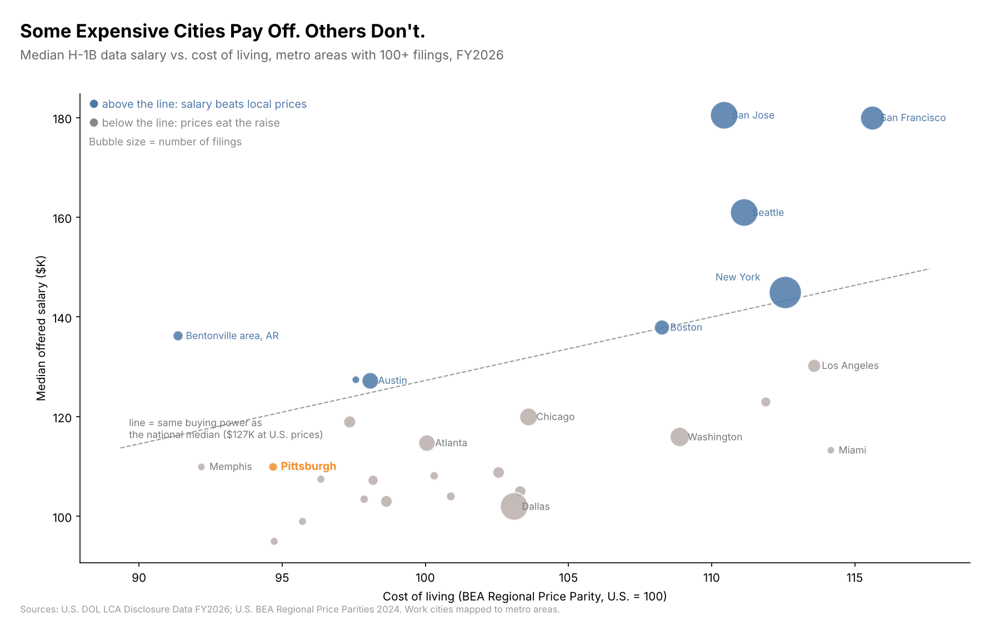
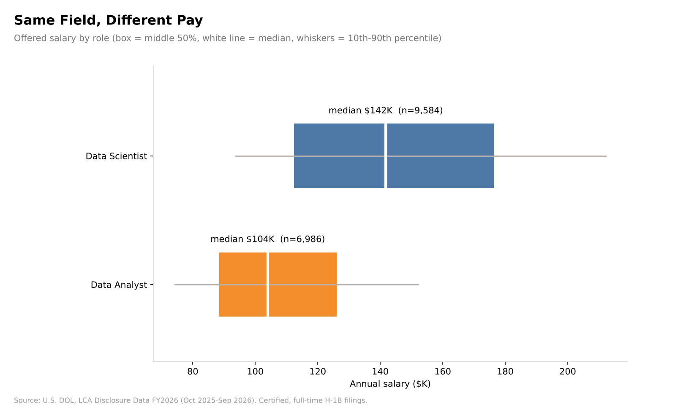

| [home page](https://imsh4ron.github.io/dataviz-portfolio/) | [data viz examples](dataviz-examples) | [critique by design](critique-by-design) | [final project I](final-project-part-one) | [final project II](final-project-part-two) | [final project III](final-project-part-three) |

[← Back to portfolio home](https://imsh4ron.github.io/dataviz-portfolio/)

# Final Project Part II: Is Your Data Job Offer a Good One?

*Storyboard, draft data visualizations, and user research*

**Quick recap from [Part I](final-project-part-one):** I am telling a story for international students who are looking for data analyst and data scientist jobs in the U.S. I use public H-1B salary filings (DOL LCA data, FY2026) to show how pay changes by company, city and job title, and I end with a tool where readers can compare their own offer with similar filings.

# Wireframes / storyboards

## Storyboard

The final story will be one scrolling page in Shorthand. The storyboard below shows the six sections in order. It follows the setup, conflict, resolution arc from Part I.

<table>
<tr>
<td width="33%" valign="top"><b>1. Hook (setup)</b>  <i>Hypothetical scenario:</i> "You just got a $95K data analyst offer in Pittsburgh. Is that high or low?"  <small>Opening text block, no chart</small></td>
<td width="33%" valign="top"><b>2. Who hires (conflict)</b>  <small>The biggest sponsors aren't the best payers</small></td>
<td width="33%" valign="top"><b>3. Where (conflict)</b>  <small>Some expensive metros pay off, others don't</small></td>
</tr>
<tr>
<td valign="top"><b>4. What role (conflict)</b>  <small>Job title changes pay: $104K vs. $142K</small></td>
<td valign="top"><b>5. Your offer (resolution)</b>  <small>Interactive: compare your offer with similar filings</small></td>
<td valign="top"><b>6. Takeaway (resolution)</b>  1. Compare offers within the same city 2. Check the job title, not just the field 3. Bring data into salary talks  <small>Short close, plus data notes and limits</small></td>
</tr>
</table>

| # | Section | Part of the arc | What the reader sees | Main message |
|---|---|---|---|---|
| 1 | Hook | Setup | A hypothetical offer: "You just got a $95K data analyst offer in Pittsburgh. Is that high or low?" | Most of us just guess |
| 2 | Who hires | Conflict | Top 15 employers: filings and median salary side by side | The biggest sponsors aren't the best payers |
| 3 | Where | Conflict | Median salary vs. regional price level by metro | Some expensive metros pay off, others don't |
| 4 | What role | Conflict | Salary range for Data Analyst vs. Data Scientist | The job title makes a big difference |
| 5 | Your offer | Resolution | Interactive tool: pick city and role, type a salary | Compare your offer with similar filings |
| 6 | Takeaway | Resolution | Three short tips, plus data notes and limits | Look at the city and role, not just the number |

## Draft data visualizations

All charts use real data: 16,570 certified, full-time H-1B data analyst and data scientist filings from FY2026 (October 2025 to September 2026). Every chart has a title that states the main point, a subtitle that says what is shown, direct labels where possible, and a source line.

### Section 2: Who hires (built in Tableau Public)

Left: number of filings. Right: median offered salary. Only Amazon and Capital One are colored, because they have the most filings but rank #10 and #13 in pay among the top 15. The dashed line is the median for all data jobs ($124K). Filing counts are applications, not confirmed hires.

[Open in Tableau Public](https://public.tableau.com/views/finalproject_17949784635000/Dashboard1)

<noscript></noscript><object class='tableauViz' style='display:none;'><param name='host_url' value='https%3A%2F%2Fpublic.tableau.com%2F' /><param name='embed_code_version' value='3' /><param name='site_root' value='' /><param name='name' value='finalproject_17949784635000&#47;Dashboard1' /><param name='tabs' value='no' /><param name='toolbar' value='yes' /><param name='static_image' value='https://public.tableau.com/static/images/fi/finalproject_17949784635000/Dashboard1/1.png' /><param name='animate_transition' value='yes' /><param name='display_static_image' value='yes' /><param name='display_spinner' value='yes' /><param name='display_overlay' value='yes' /><param name='display_count' value='yes' /><param name='language' value='en-US' /><param name='filter' value='publish=yes' /></object>

### Section 3: Where

Each bubble is a metro area with 90+ filings. The x-axis is the BEA Regional Price Parity (U.S. = 100), which compares local price levels; it is not the same as actual living costs. Bubbles above the dashed line have higher salaries than their price level alone would suggest. Pittsburgh is highlighted in orange because it is where my readers are now.

### Section 4: What role

Data Analyst median is $104K and Data Scientist median is $142K. The box shows the middle 50% of salaries. Roles are grouped by job title only (see [Part I](final-project-part-one) for the exact rules).

### Section 5: Your offer (design draft for the interactive tool)

This is a mockup of the Tableau dashboard I will build for Part III. The reader picks a city and role and types a salary. The example shows a $95K data analyst offer in Pittsburgh, which is higher than 63% of the 35 matching filings. The tool will always show the sample size and a note that it does not account for experience, level, bonus or stock.

### Next steps for the draft
- Rebuild Sections 3 to 5 in Tableau Public (Section 2 is already done)
- Build the Shorthand page and embed the Tableau charts in order
- Write the short text that connects each section

# User research

## Research goal

I wanted to find out whether students could easily follow my story, understand the salary comparisons, and use the information to evaluate data job offers. I was also interested in what other factors they would consider besides base salary.

## Target audience and approach

My target audience is international graduate students interested in data-related jobs. I interviewed three people with different levels of experience and asked them to review my storyboard and draft visualizations. To protect their privacy, I describe them only in general terms.

- **Participant A:** International graduate student currently looking for data jobs
- **Participant B:** Graduate student with a background in data analytics
- **Participant C:** Recent graduate working in a data-related role

Each interview took around 10 to 15 minutes. I showed participants the draft story, asked them to talk through anything they found confusing, and took notes on their feedback.

## Interview script

| Goal | Questions to ask |
|------|------------------|
| First impression | 1. What's your first impression of the project? |
| Story flow | 2. Is the story easy to follow? Is anything confusing? |
| Chart usefulness | 3. Which chart do you find most useful, and why? |
| Data understanding | 4. Does the difference between H-1B filings and actual hires make sense? |
| Salary checker design | 5. What would you want to see in the salary checker? |
| Beyond salary | 6. Besides salary, what else matters to you when comparing job offers? |

# Interview findings

| Participant | Key feedback | Potential improvement |
|---|---|---|
| **A: International grad student looking for jobs** | "The salary checker sounds really useful, but I'd want to know how many other offers it's comparing mine to." | Show the sample size for each comparison. |
| **B: Grad student with data analytics experience** | "I like the company chart, but I wasn't sure whether those numbers were actual hires or just applications." | Add a clearer note explaining what LCA filings mean. |
| **C: Recent grad working in data** | "I'd definitely want to see the salary range. And honestly, benefits and 401(k) matching matter too, not just salary." | Add salary ranges and a note about total compensation. |

**Similarities:** All three participants wanted more information behind the numbers. Participants A and B both pointed to things that were not clear enough: how many filings are behind a comparison, and whether filings mean actual hires. Participant C wanted more than one number too, asking for the salary range. Participant A called the salary checker "really useful," and Participant B liked the company chart.

**Differences:** The participants had different priorities. Participant A, who is job searching now, focused on comparing an offer with others. Participant C, who already works in data, cared more about the full package, including salary range, benefits and 401(k) matching, not just base salary.

# Identified changes for Part III

| Research synthesis | Anticipated changes for Part III |
|--------------------|----------------------------------|
| Participant A wanted to know how many offers the salary checker compares against | Show the number of LCA filings used in every salary comparison, and add a warning when the sample is small |
| Participant B was not sure whether filing counts meant actual hires | Add a clear note next to the company chart: filing counts are applications, not confirmed hires |
| Participant C wanted to see the salary range, not just a percentile | Show the salary range (for example, the 25th to 75th percentile) next to the percentile in the salary checker |
| Participant C said benefits and 401(k) matching also matter | Add a short section noting that LCA data shows base salary only, and remind readers to compare total compensation |
| Different participants had different priorities | If time allows, compare salary patterns across employer types (tech, finance, consulting / IT services) |

# AI acknowledgements
I used Claude (Anthropic) to help build the storyboard layout, make the matplotlib draft charts for Sections 3 to 5 from my cleaned data, and organize my interview notes into the findings and change tables. I built the Section 2 chart in Tableau myself, chose the final interview questions, and conducted the interviews myself.
