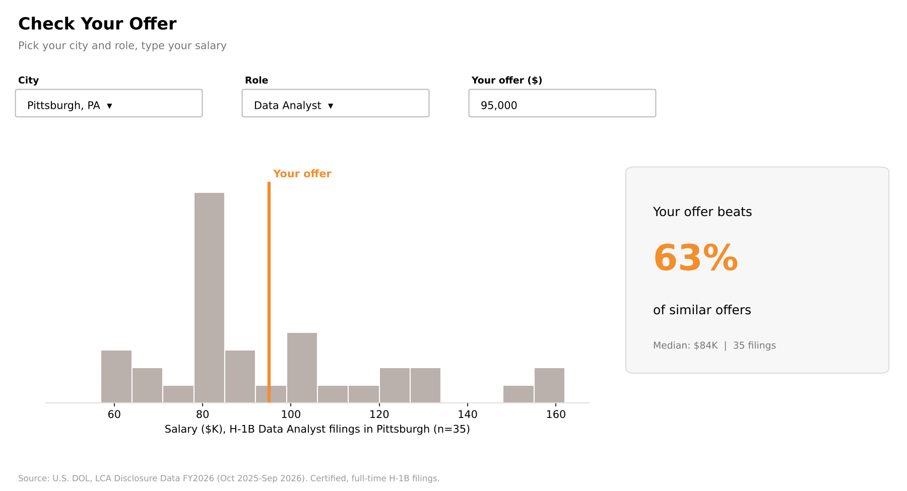

| [home page](https://imsh4ron.github.io/dataviz-portfolio/) | [data viz examples](dataviz-examples) | [critique by design](critique-by-design) | [final project I](final-project-part-one) | [final project II](final-project-part-two) | [final project III](final-project-part-three) |

[← Back to portfolio home](https://imsh4ron.github.io/dataviz-portfolio/)

# Final Project Part II: Is Your Data Job Offer a Good One?

*Storyboard, draft data visualizations, and user research*

**Quick recap from [Part I](final-project-part-one):** I am telling a story for international students who are looking for data analyst and data scientist jobs in the U.S. I use public H-1B salary filings (DOL LCA data, FY2026) to show how pay changes by company, city and job title, and I end with a tool where readers can compare their own offer with similar filings.

# Wireframes / storyboards

## Storyboard

The final story will be one scrolling page in Shorthand. The storyboard below shows the six sections in order. It follows the setup, conflict, resolution arc from Part I.

<table>
<tr>
<td width="33%" valign="top"><b>1. Hook (setup)</b>  <i>Hypothetical scenario:</i> "You just got a $95K data analyst offer in Pittsburgh. Is that high or low?"  <small>Opening text block, no chart</small></td>
<td width="33%" valign="top"><b>2. Who hires (conflict)</b>  <small>The biggest sponsors aren't the best payers</small></td>
<td width="33%" valign="top"><b>3. Where (conflict)</b>  <small>Some expensive metros pay off, others don't</small></td>
</tr>
<tr>
<td valign="top"><b>4. What role (conflict)</b>  <small>Job title changes pay: $104K vs. $142K</small></td>
<td valign="top"><b>5. Your offer (resolution)</b>  <small>Interactive: compare your offer with similar filings</small></td>
<td valign="top"><b>6. Takeaway (resolution)</b>  1. Compare offers within the same city 2. Check the job title, not just the field 3. Bring data into salary talks  <small>Short close, plus data notes and limits</small></td>
</tr>
</table>

| # | Section | Part of the arc | What the reader sees | Main message |
|---|---|---|---|---|
| 1 | Hook | Setup | A hypothetical offer: "You just got a $95K data analyst offer in Pittsburgh. Is that high or low?" | Most of us just guess |
| 2 | Who hires | Conflict | Top 15 employers: filings and median salary side by side | The biggest sponsors aren't the best payers |
| 3 | Where | Conflict | Median salary vs. regional price level by metro | Some expensive metros pay off, others don't |
| 4 | What role | Conflict | Salary range for Data Analyst vs. Data Scientist | The job title makes a big difference |
| 5 | Your offer | Resolution | Interactive tool: pick city and role, type a salary | Compare your offer with similar filings |
| 6 | Takeaway | Resolution | Three short tips, plus data notes and limits | Look at the city and role, not just the number |

## Draft data visualizations

All charts use real data: 16,570 certified, full-time H-1B data analyst and data scientist filings from FY2026 (October 2025 to September 2026). Every chart has a title that states the main point, a subtitle that says what is shown, direct labels where possible, and a source line.

### Section 2: Who hires (built in Tableau Public)

Left: number of filings. Right: median offered salary. Only Amazon and Capital One are colored, because they have the most filings but rank #10 and #13 in pay among the top 15. The dashed line is the median for all data jobs ($124K). Filing counts are applications, not confirmed hires.

[Open in Tableau Public](https://public.tableau.com/views/finalproject_17949784635000/Dashboard1)

<noscript></noscript><object class='tableauViz' style='display:none;'><param name='host_url' value='https%3A%2F%2Fpublic.tableau.com%2F' /><param name='embed_code_version' value='3' /><param name='site_root' value='' /><param name='name' value='finalproject_17949784635000&#47;Dashboard1' /><param name='tabs' value='no' /><param name='toolbar' value='yes' /><param name='static_image' value='https://public.tableau.com/static/images/fi/finalproject_17949784635000/Dashboard1/1.png' /><param name='animate_transition' value='yes' /><param name='display_static_image' value='yes' /><param name='display_spinner' value='yes' /><param name='display_overlay' value='yes' /><param name='display_count' value='yes' /><param name='language' value='en-US' /><param name='filter' value='publish=yes' /></object>

### Section 3: Where

Each bubble is a metro area with 90+ filings. The x-axis is the BEA Regional Price Parity (U.S. = 100), which compares local price levels; it is not the same as actual living costs. Bubbles above the dashed line have higher salaries than their price level alone would suggest. Pittsburgh is highlighted in orange because it is where my readers are now.

### Section 4: What role

Data Analyst median is $104K and Data Scientist median is $142K. The box shows the middle 50% of salaries. Roles are grouped by job title only (see [Part I](final-project-part-one) for the exact rules).

### Section 5: Your offer (design draft for the interactive tool)

This is a mockup of the Tableau dashboard I will build for Part III. The reader picks a city and role and types a salary. The example shows a $95K data analyst offer in Pittsburgh, which is higher than 63% of the 35 matching filings. The tool will always show the sample size and a note that it does not account for experience, level, bonus or stock.

### Next steps for the draft
- Rebuild Sections 3 to 5 in Tableau Public (Section 2 is already done)
- Build the Shorthand page and embed the Tableau charts in order
- Write the short text that connects each section

# User research

## Target audience

**Who I hope to reach:** international graduate students in data programs (for example, Heinz MSISPM/BIDA or similar programs) who are searching for or comparing full-time data analyst or data scientist jobs in the U.S.

**How I will find people to interview:**
- I will interview 3 people who match this audience as closely as possible: current graduate students in data-related programs who plan to look for U.S. data jobs.
- I will try to include a mix: at least one person who has already started job searching, and at least one person who is earlier in the process. If possible, I will include one person who is not in a data program, to check whether the story is clear to a general reader.
- I will find people through classmates and student groups. I will not record names or any personal details on this page; I will only describe each person generally (for example, "MS student, data program, job searching now").

**How the sessions will work:** each session is about 10 to 15 minutes. I will show the storyboard and the draft charts one section at a time, ask the person to think out loud, and take notes. I will not explain a chart before asking the questions, so I can see if it makes sense on its own.

## Interview script

**Research goals**
1. Check if the story is easy to follow from the hook to the end
2. Check if each chart's main point is clear without my explanation
3. Learn what information my audience actually wants when they compare offers
4. Find confusing words, labels or design choices before Part III

| Goal | Questions to ask |
|------|------------------|
| Warm-up and context | 1. Are you looking for a full-time data job now, or planning to soon? 2. When you get (or imagine getting) an offer, how would you decide if the salary is good? |
| Story flow | 3. Looking at the storyboard, can you tell me in one sentence what this story is about? 4. Does the order of the sections make sense? Is anything missing? |
| Chart clarity: Who hires | 5. What is the first thing you notice in this chart? 6. Why do you think Amazon and Capital One are in orange? |
| Chart clarity: Where | 7. What do you think the dashed line means? 8. Is "regional price parity" clear, or would another label help? |
| Chart clarity: What role | 9. What does this chart tell you about Data Analyst vs. Data Scientist pay? Is anything surprising? |
| Usefulness: Your offer | 10. Would you use this tool? What would you type in first? 11. Does the sample size note change how much you trust the result? |
| Trust and wrap-up | 12. Is there anything that makes you doubt the data? 13. What one thing would make this story more useful for you? |

# Interview findings

*To be added after the interviews.* I will add one column per person (described generally, with no personal details), key quotes for each question, and a summary of where people agreed and where they disagreed.

| Questions | Interview 1 | Interview 2 | Interview 3 |
|-----------|-------------|-------------|-------------|
| Story in one sentence | | | |
| First thing noticed (Who hires) | | | |
| Dashed line meaning (Where) | | | |
| Analyst vs. Scientist takeaway | | | |
| Would you use the offer tool? | | | |
| What would make it more useful? | | | |

**Similarities:** *to be added*

**Differences:** *to be added*

# Identified changes for Part III

*To be added after the interviews.* Each change will link back to a specific finding.

| Research synthesis | Anticipated changes for Part III |
|--------------------|----------------------------------|
| | |
| | |
| | |

# AI acknowledgements
I used Claude (Anthropic) to help build the storyboard layout, make the matplotlib draft charts for Sections 3 to 5 from my cleaned data, and draft the structure of the interview script, which I reviewed and edited. I built the Section 2 chart in Tableau myself. The interviews and findings are my own work.
